# CareSaath — a family health graph an agent can act on

One app for a family's health records: every confirmed record becomes
**connected evidence in FalkorDB**, so the agent can answer *"what do I still
need to clarify before the appointment?"* with a source behind every claim —
and show the exact graph path the answer came from.

- **Live demo:** <https://caresaath-app.vercel.app>
- **Demo video:** <https://youtube.com/watch?v=7AlRPuM_bwQ>
- **Track:** 01 — Agents That Act on Connected Data

> Not a diagnostic tool — it only explains what the records say.
> There is no sign-in: anyone who can reach the API can read every profile in it.

[](https://youtube.com/watch?v=7AlRPuM_bwQ)

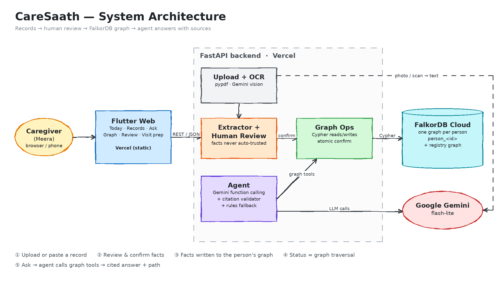

---

## Screenshots

| Today: derived status + what changed | Only the connected item changes |
|---|---|
| 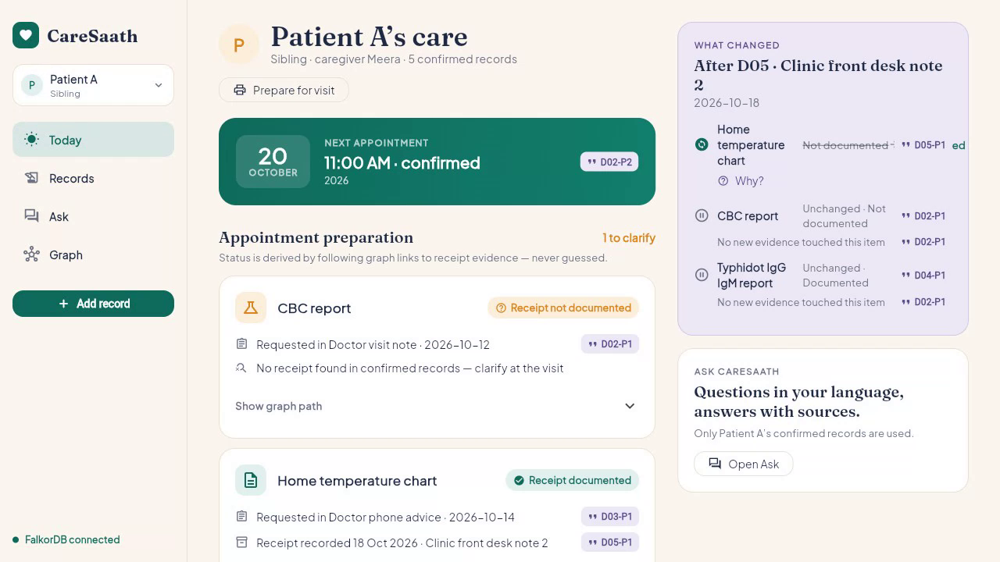 | 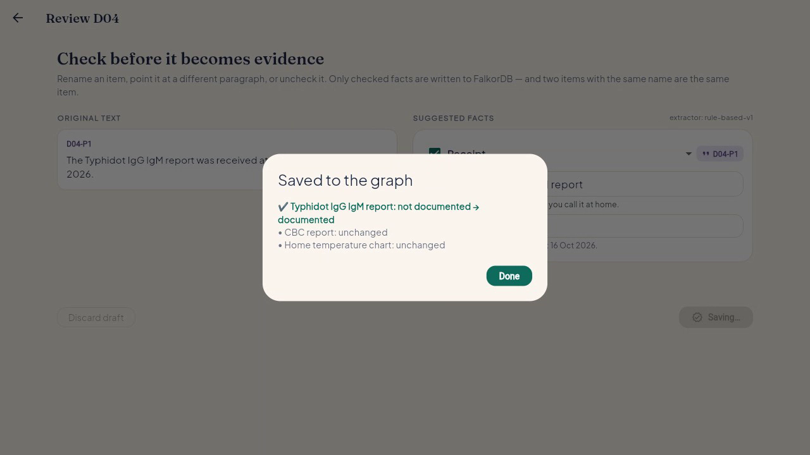 |
| **Why? — request, receipt and the path between them** | **One item, two sources in the graph** |
| 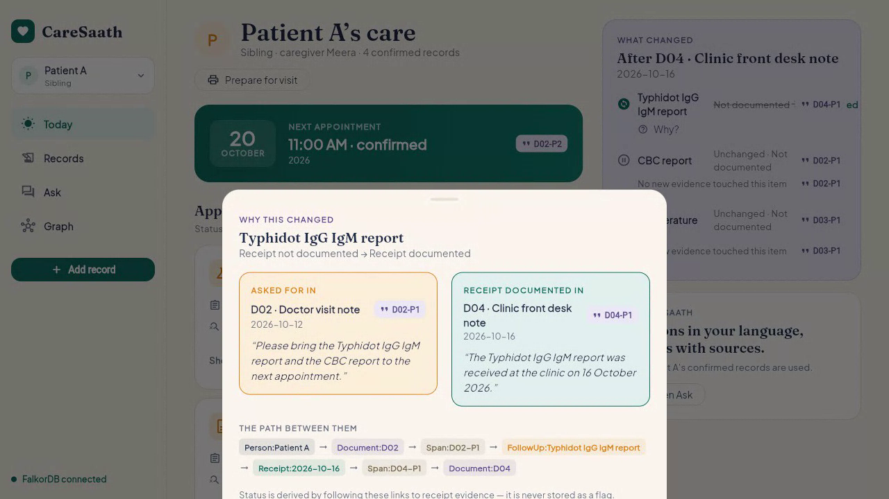 | 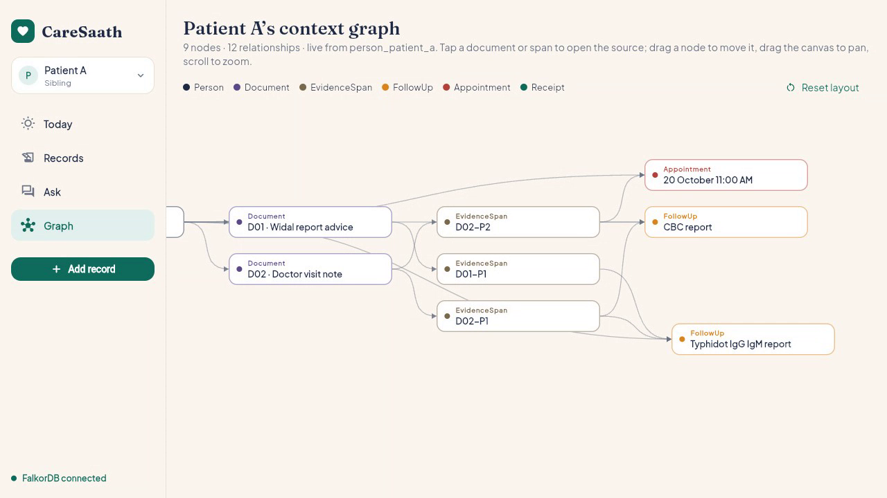 |
| **Ask: sourced answer + agent tool trace** | **Show in graph: the path behind the answer** |
| 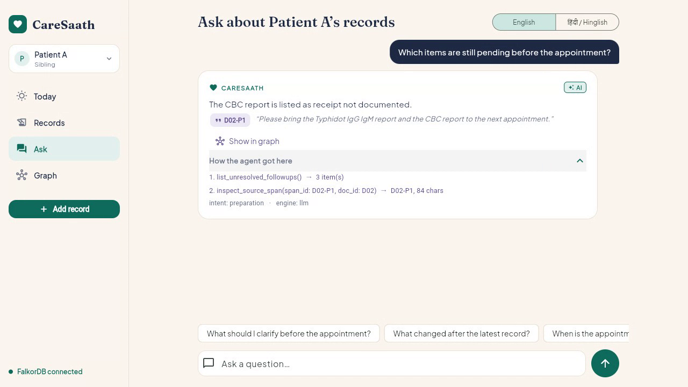 | 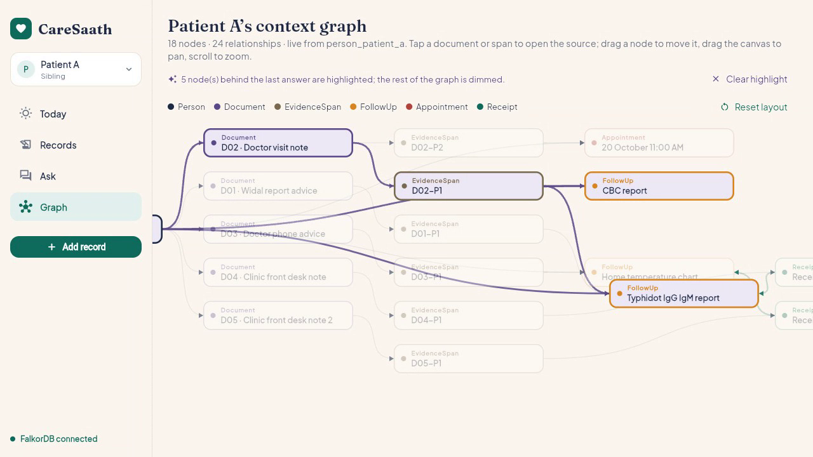 |
| **Human review before anything is evidence** | **Visit preparation sheet** |
| 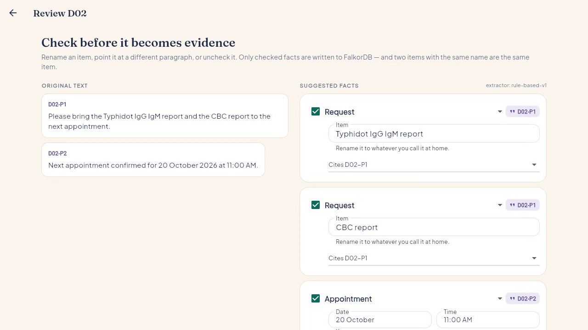 | 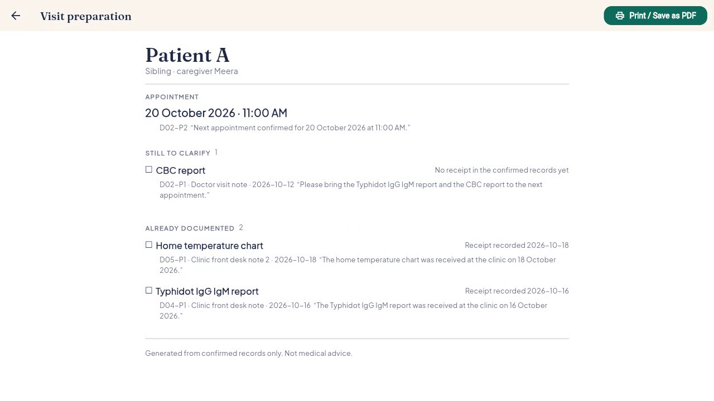 |

<details><summary>More: source chip and medical-advice refusal</summary>

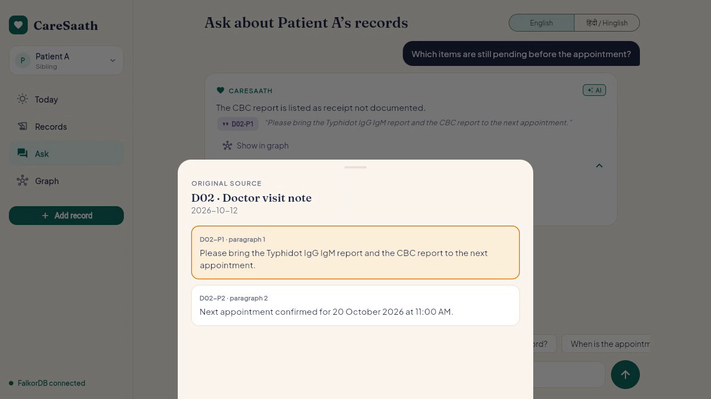
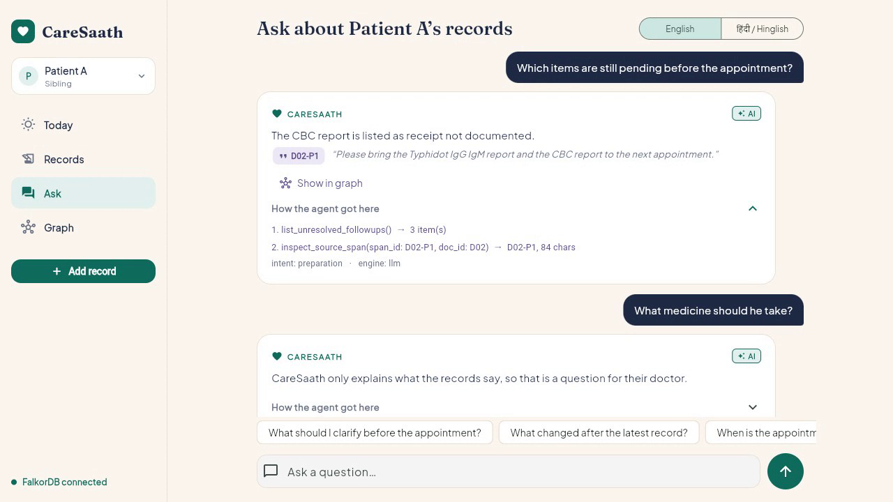

</details>

## Try it in 2 minutes

Open the [live demo](https://caresaath-app.vercel.app), create a profile, then add these
records one by one (**Add record** → title → date → paste → **Extract & review** → **Confirm**):

| # | Title | Date | Text |
|---|---|---|---|
| R1 | Widal report advice | 2026-10-10 | Please bring the Typhidot IgG IgM report to the next appointment. |
| R2 | Doctor visit note | 2026-10-12 | Please bring the Typhidot IgG IgM report and the CBC report to the next appointment.<br><br>Next appointment confirmed for 20 October 2026 at 11:00 AM. |
| R3 | Doctor phone advice | 2026-10-14 | Please bring the home temperature chart to the next appointment. |
| R4 | Clinic front desk note | 2026-10-16 | The Typhidot IgG IgM report was received at the clinic on 16 October 2026. |
| R5 | Clinic front desk note 2 | 2026-10-18 | The home temperature chart was received at the clinic on 18 October 2026. |

(In R2, leave a blank line between the two sentences.) Then open **Today** (only the CBC report is
still pending), tap **Why?**, open **Graph**, and in **Ask** try *"Which items are still pending
before the appointment?"* and *"What medicine should he take?"*. All demo data is fictional.

## The problem

A family's health records live in WhatsApp forwards, PDFs in a downloads folder
and photos of paper slips. The clinic asks for the old lab report; three weeks
later nobody can say whether it was ever handed over. Before a visit the
question *"what is still pending?"* has no answer except scrolling, and a new
record never tells you what it changed and what it left alone.

## Graph model

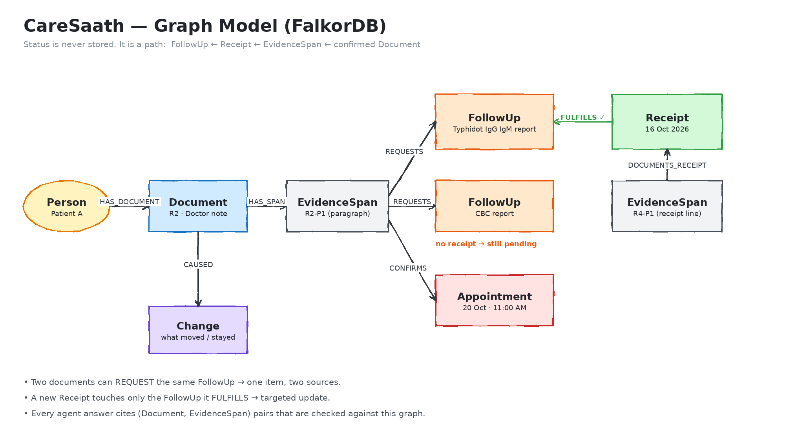

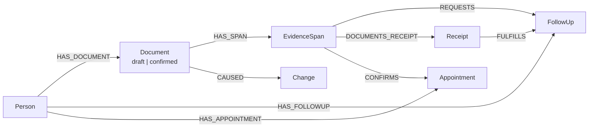

| Node | What it is |
|---|---|
| `Person` | One family member. Name, relation, caregiver. |
| `Document` | One record as it arrived — pasted text, a PDF's text layer, or a transcribed photo. `status` is `draft` until a human confirms it. |
| `EvidenceSpan` | One citable paragraph of a document (`D01-P2`). Every claim in an answer points at one of these. |
| `FollowUp` | Something the clinic asked for, identified by its normalized name (`existing lab report` → `fu:existing_lab_report`), so renaming an item on the Review screen is also how you merge duplicates. |
| `Receipt` | Evidence that a requested item actually arrived, carrying the date the record gave. |
| `Appointment` | A confirmed date + time. The year is part of its identity, so "20 October" in two years is two appointments. |
| `Change` | What one confirm moved: which follow-ups changed, stayed the same, or were newly added. Backs the "Why?" view. |

**One isolated graph per person.** Each profile's records live in its own graph,
`person_<id>` (`db.graph_name`), and a small registry graph (`caresaath_people`)
holds nothing but the list of profiles. Every endpoint takes a `person_id` and
only ever opens that person's graph — including the agent's tools, which are
bound to one person before the model is asked anything.

## How the graph does the work

1. **Status is derived by traversal, never stored as a flag.** There is no
   `done: true` anywhere. A follow-up counts as settled only if the graph can
   walk `FollowUp ← FULFILLS ← Receipt ← DOCUMENTS_RECEIPT ← EvidenceSpan ←
   HAS_SPAN ← Document {status:'confirmed'}`. An unconfirmed draft leaves the
   document end of that walk null, so a draft can never close anything, and a
   confirm that died half-way leaves nodes nothing confirmed points at — which
   every reader skips instead of showing. The main query is `PREP_CYPHER` in
   `backend/app/graph_ops.py`, also returned by `GET /preparation`:

   ```cypher
   MATCH (p:Person {id:$pid})-[:HAS_FOLLOWUP]->(f:FollowUp)
   OPTIONAL MATCH (rs:EvidenceSpan)-[:REQUESTS]->(f)
   OPTIONAL MATCH (rd:Document {status:'confirmed'})-[:HAS_SPAN]->(rs)
   WITH p, f, collect(DISTINCT {span_id:rs.id, doc_id:rd.id, doc_title:rd.title,
                                date:rd.date, text:rs.text}) AS requested_by
   OPTIONAL MATCH (f)<-[:FULFILLS]-(r:Receipt)<-[:DOCUMENTS_RECEIPT]-(es:EvidenceSpan)
                  <-[:HAS_SPAN]-(ed:Document {status:'confirmed'})
   RETURN f.id AS id, f.item AS item, f.label AS label, requested_by,
          collect(DISTINCT {span_id:es.id, doc_id:ed.id, doc_title:ed.title,
                            date:r.date, date_source:r.date_source,
                            text:es.text}) AS receipts
   ORDER BY f.label
   ```

   Because request and receipt both come back with their dates, a *repeat*
   request reopens an item: a receipt older than the newest request does not
   close it.

2. **A new record updates only the connected item.** `MERGE` on the follow-up's
   derived key attaches the new evidence to the item it belongs to and touches
   nothing else. The confirm snapshots the derived statuses before and after,
   diffs them, and writes a `Change` node — so the app can say *this moved,
   these stayed exactly as they were*, and the "Why?" view can show the request
   that opened an item and the receipt that settled it, each with its own span.

3. **The agent's tools are graph queries.** Four read-only tools, each closed
   over one `pid` (`agent.tools_for`): `retrieve_patient_context`,
   `list_unresolved_followups`, `latest_change`, `inspect_source_span`. Gemini
   chooses among them; it never sees the database or writes Cypher. Every claim
   it returns carries the `(doc_id, span_id)` pairs it rests on, and
   `validate_sources()` checks each pair against the set of pairs the tools
   actually returned, dropping anything else. An invented citation becomes a
   claim with no evidence chip — never a fabricated source.

4. **"Show in graph" highlights the exact path behind an answer.** The cited
   spans and their documents, plus whatever those spans actually evidence (the
   follow-up a span requests, the receipt it documents, the appointment it
   confirms), are resolved against the same subgraph the Graph screen draws
   (`answer_path`), so a highlighted path can never name a node that is not on
   screen. An answer that cites nothing highlights nothing.

## Agent flow

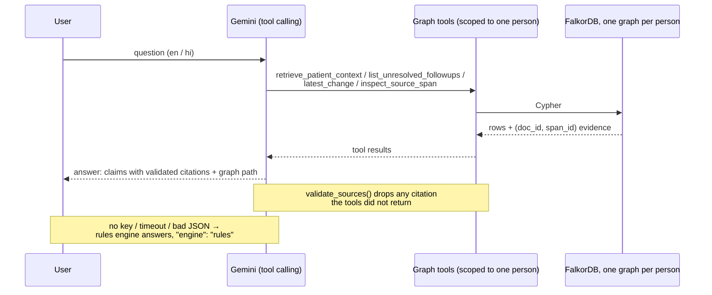

The rules engine is the deterministic original agent, kept whole as the floor
the product never falls below: it routes by keyword to the same tools and
composes templated claims from the same graph rows. Both engines refuse
medical, dosage and diagnosis questions.

## Features

- **Many profiles, one app.** Each family member has their own records,
  follow-ups and graph; the switcher in the shell moves between them.
- **Add a record** by pasting text or uploading a PDF or photo. A PDF with a
  text layer is read with pypdf; anything else is transcribed by Gemini, which
  is told to transcribe only — no summarising, translating or correcting.
- **Human review is the gate.** The extractor suggests facts; you rename an
  item, point it at a different paragraph, change its type, or uncheck it. Only
  confirmed facts reach the graph.
- **Today** — the appointment and every follow-up with its derived status, the
  evidence behind it, and the graph path that derived it.
- **Ask** — questions in English or Hindi/Hinglish, answered only from that
  person's confirmed records, with a source chip under each claim, the tool
  trace, and an **AI**/**Rules** badge saying which engine answered.
- **Graph** — that person's live subgraph; tap a document or span for the
  original words, or highlight the path behind the last answer.
- **Visit preparation** — a printable sheet in preparation order, every line
  with the quote it came from.

## Tech stack

| Part | Tech |
|---|---|
| App (web + Android) | Flutter / Dart (`frontend/`), deployed on Vercel |
| API + agent | Python, FastAPI (`backend/`), deployed on Vercel |
| Context graph | FalkorDB Cloud + Cypher (`docker-compose.yml` locally) |
| LLM | Gemini — tool calling in Ask, transcription for uploads |

## Run locally

**1. FalkorDB** — persistent volume, browser on :3000:

```bash
docker compose up -d
```

**2. Backend:**

```bash
cd backend
python -m venv .venv && source .venv/bin/activate   # Windows: .venv\Scripts\activate
pip install -r requirements.txt
cp .env.example .env     # then put a free Gemini key in GEMINI_API_KEY
uvicorn app.main:app --reload --port 8000
```

The key is optional: without it the agent answers from the rules engine and says
so (`"engine": "rules"`), and an upload with no text layer is refused rather
than guessed at. Get one free at <https://aistudio.google.com/apikey>; `.env` is
gitignored. Nothing is seeded — the app starts empty and you create the first
profile in the UI. Check <http://localhost:8000/health> and `/docs`.

No Docker? `pip install falkordblite` and run with `FALKORDB_EMBEDDED=1`
(Linux/macOS only — `redislite` does not build on Windows).

**3. Flutter app:**

```bash
cd frontend
flutter pub get
flutter run -d chrome
```

Android emulator: `flutter run -d emulator-5554 --dart-define=API_URL=http://10.0.2.2:8000`.
To build the deployed web bundle: `./build_web.ps1 https://<backend-url>`, which
compiles `API_URL` into the build.

## API

Every path except `/health` and `/people` takes a `person_id` query parameter,
and returns 404 if no such profile exists.

| Method | Path | Purpose |
|---|---|---|
| GET | /health | API + graph status |
| POST / GET | /people | create a profile `{name, relation, caregiver?}` / list profiles |
| GET / DELETE | /people/{id} | profile + appointments / delete it and drop its graph |
| GET | /records, /records/{id} | timeline, original source with spans |
| POST | /records/preview | draft + suggested facts (not used in answers) |
| POST | /people/{id}/records/upload | PDF or photo → text → the same draft flow |
| POST | /records/{id}/confirm | write reviewed facts → graph, returns the change diff |
| DELETE | /records/{id} | discard a draft |
| GET | /preparation | follow-ups with derived status, sources, graph path |
| GET | /changes/latest | last change (changed / unchanged / added) |
| GET | /graph | subgraph for the graph view |
| POST | /ask | `{answer, claims, sources, trace, intent, engine}` (lang: en/hi) |

## Safety

- **No diagnosis, no medical advice.** The app explains what a person's own
  records say and nothing more. Both engines refuse dosage, diagnosis and
  "is it safe" questions outright, without reading any records.
- **Human review before anything becomes evidence.** Extraction and
  transcription only ever produce a *draft*. A person confirms each fact — and
  can rename it, re-point it, retype it or drop it — before it enters the graph,
  and nothing unconfirmed is ever read by the agent.
- **Citations are enforced server-side.** A claim can only cite evidence the
  tools returned; anything else is dropped before it reaches the screen.
- **Per-person isolation is structural**, not a filter: one graph per profile.

## Limitations

- **No auth.** Every profile on the server is visible to anyone who can reach
  the API — think before putting real health data in the live demo.
- Extraction is rule-based: it reads request/receipt phrasings sentence by
  sentence, so it over- and under-matches. Human review is the safety net, and
  every date, time and item name is editable there.
- Free-tier Gemini Flash: on a rate limit, a 20s timeout or malformed JSON the
  answer drops to the rules engine, which is more rigid and routes to three of
  the four tools. The fallback also refuses by keyword, so it misses phrasings
  and occasionally refuses a records question that merely says "dose".
- **A confirm is not one transaction.** Facts are written with several queries
  and FalkorDB gives no rollback across them. A confirm that dies half-way is
  made *invisible* rather than undone — a follow-up with no confirmed evidence
  behind it is skipped by `/preparation`, `/graph` and the agent's tools — but
  the orphan nodes stay in the graph.
- An appointment only has a year if the record stated one. Without it, it cannot
  be ordered against today and is shown as "appointment on record", year unknown.
- A follow-up is one item, not one episode per request. Repeat requests reopen
  it by date, but the history of each round is not kept separately.
- English + Hindi/Hinglish answers only; UI chrome is English.
- The FalkorDB connection is plain TCP, so a server that requires TLS is not
  supported yet.
